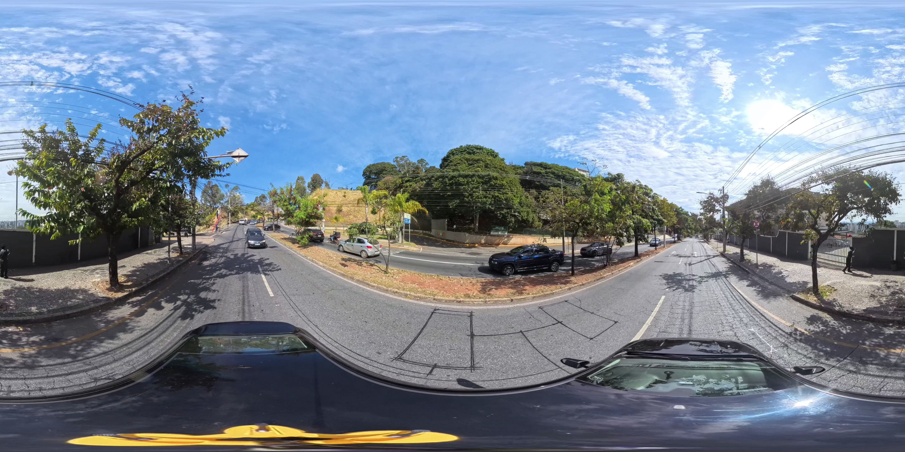

# Pipeline de Anotacao 360

Esse repositório é a entrega do desafio tecnico de anotacao automatizada em imagens 360.

O problema principal aqui é que imagens equiretangulares distorcem, entao rodar um modelo de IA direto nelas nao é o ideal. A solucao implementada foi extrair varias perspectivas (simulando cameras virtuais), passar o GroundingDINO nelas pra detectar os carros, e depois fazer a matematica reversa pra desenhar os bounding boxes de volta na imagem original.

## Como rodar
Fiz o setup usando o `pyproject.toml` pra nao ter erro de versao com as dependencias.

1. Criar um ambiente virtual sua maquina:
```bash
python3 -m venv venv
source venv/bin/activate
```

2. Instalar as dependências (via .toml)
```bash
pip install .
```

3. rodar código principal
```bash
python3 main.py --pitch {valor} --yaw {valor} --fov {valor}
```
valores default se não forem passados como parametros:
    --pitch:30
    --yaw:45
    --fov:90

## Sobre a Reprojeção:
Na foto plana, o bounding box é um quadrado perfeito. Quando a gente projeta isso de volta pro mapa 360, o poligono entorta e as linhas ficam curvas. Resolvi isso da seguinte maneira:

Fiz a parte da reprojeção do zero pois não achei uma lib muito adequada pra isso. Algumas libs até se assemelham (e.g. astropy_spherical_to_cartesian), mas não lidavam muito bem com o que foi proposto.

A ideia foi criar uma função que faz a projeção reversa de um pixel específico da perspectiva plana de volta para a matriz equirectangular.

Dessa maneira, eu jogo os 4 cantos do bounding box local nessa funcao pra achar o (x,y) de cada vértice na imagem 360 global. Depois eu tiro o min() e o max() desses 4 pontos distorcidos.

Com isso, eu garanto a criação de um novo retangulo reto e alinhado com os eixos da imagem que engloba 100% da área do objeto, sem cortar nenhum pedaço do carro.

## Sobreposicao e NMS
Como a gente faz uma varredura girando a câmera, o mesmo carro acaba aparecendo em mais de uma vista e gera deteçõoes duplicadas.

Pra limpar isso, juntei as coordenadas finais e a taxa de confiança (score) de todas as caixas numa lista e apliquei o algoritmo de NMS (cv2.dnn.NMSBoxes) do OpenCV. Ele calcula a interseção e deixa so um bounding box definitiva por carro


## Desafios:
A parte mais complexa foi conseguir de fato entender e aprender o que foi proposto. Nao conhecia muitos conceitos e nem havia trabalhado com deteção neste sentido.

Incrivelmente achei a parte matematica mais intuitiva, e, como eu ja havia mexido com matrizes de rotação e afins, consegui entender as projeções de forma mais facil.

Achei o conceito de Zero-Shot complexo e nao muito simples de compreender. Achei a documentação do Audistill/GroundingDINO escassa e sem sentido.
    
    
## Comentarios:

A detecção ainda não está perfeita e o código pode ser em muito melhorado.
Mesmo ajustando alguns parâmetros, a detecção falha em alguns pontos.
      
Adicionei um documento "sources.txt" do qual cita as principais referencias que usei.
    
Usei IA de forma muito restrita, e nunca para me dar código pronto. Ela me auxiliou com a estruturação, quando eu me perdia e não sabia os próximos passos, e também com alguns pontos de debug. Ex: Me ajudou a debugar uma imcompatibilidade de biblioteca antiga com o numpy (da qual pode ser vista no codigo principal com comentário --PATCH--)
   
   
## Resultados

### Exemplo

Antes do processamento:


Depois do pipeline:


## Video Explicativo

Fiz um video explicando as etapas do codigo. Está no youtube:

URL: https://www.youtube.com/watch?v=1_BSF1VGjt4

OBS: O vídeo é privado, e só quem tem o link consegue acessar. Não compartilhei com ninguém mais além do julianomasson.
